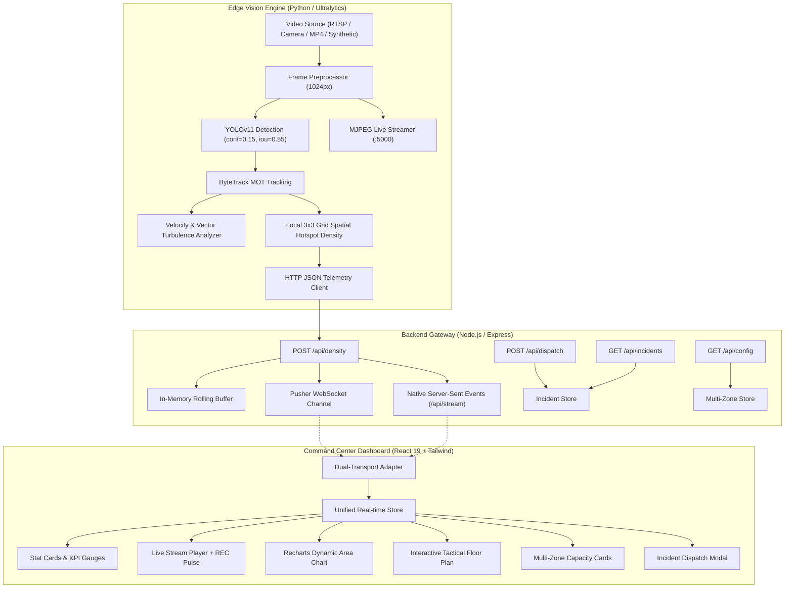
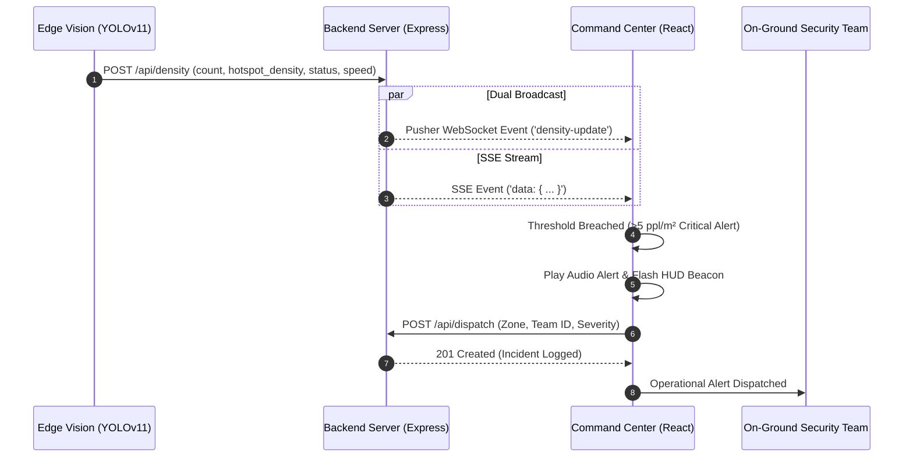

# Drishti-Safe : CrowdFlow Command Center

<div align="center">


**Autonomous AI-Powered Stampede Prevention & Bottleneck Intelligence for High-Density Venues**

[](https://react.dev/)
[](https://vitejs.dev/)
[](https://tailwindcss.com/)
[](https://github.com/ultralytics/ultralytics)
[](https://github.com/ifzhang/ByteTrack)
[](https://expressjs.com/)
[](https://pusher.com/)
[](https://python.org/)
[](LICENSE)

</div>

---

## 📌 Problem Statement

Every year, tragic crowd disasters, stampedes, and progressive crowd collapses occur at major transit hubs, religious pilgrimages (e.g., Kumbh Mela, Hajj), stadiums, transit terminals, and music festivals. 

Traditional crowd control suffers from three fatal shortcomings:
1. **Human Lag & Operator Blind Spots**: Manual monitoring of hundreds of CCTV feeds fails to detect localized micro-bottlenecks before crowd panic triggers a surge.
2. **Global Averaging Fallacy**: Traditional headcounts report venue-wide metrics, masking dangerous micro-clusters (e.g., 6+ persons/m² concentrated near an exit turnstile while the rest of the hall is empty).
3. **Delayed Dispatch Action**: Disconnect between telemetry detection and security personnel deployment results in missed 30–60 second intervention windows.

**Drishti-Safe (CrowdFlow)** bridges this gap by marrying real-time **Edge Computer Vision (YOLOv11 + ByteTrack)** with spatial **hotspot localization**, dual-transport telemetry, an interactive tactical dashboard, and rapid incident dispatch.

---

## 🏗️ System Architecture



### Telemetry & Action Sequence



---

## ⚡ 60-Second Quick Start

### Option A: One-Click Windows Launchers (Recommended)

Run with PowerShell or Command Prompt from the repository root:

```powershell
# Synthetic Simulation Mode (Zero-camera required, perfect for demos)
.\start-all.ps1

# Or with Live Video inference:
.\start-all.ps1 -Mode Video -Source "3.mp4"
```

Or double-click:
```cmd
start-all.bat
```

Both scripts automatically:
1. Verify Node.js and Python dependencies.
2. Spin up the Express backend gateway on port `3000`.
3. Launch the AI Edge Engine (in simulation or video inference mode).
4. Launch the React 19 / Vite frontend on `http://localhost:5173`.
5. Open your default web browser to the Command Center dashboard.

---

### Option B: Manual Step-by-Step Launch

#### 1. Backend Service
```bash
cd backend
npm install
npm run dev # or node index.js
# Runs on http://localhost:3000
```

#### 2. AI Edge Vision Engine
```bash
cd ai
# (Optional) activate virtualenv
.\venv\Scripts\activate

# Install requirements
pip install -r requirements.txt

# Run in Synthetic Simulation Mode (demo without cameras):
python main.py --simulate

# OR Run with Live Video / Webcam / RTSP feed:
python main.py --source 3.mp4 --port 5000
# (Runs MJPEG server on http://localhost:5000/video_feed)
```

#### 3. Frontend Dashboard
```bash
cd frontend
npm install
npm run dev
# Open http://localhost:5173 in browser
```

---

## 🌟 Key Features

| Feature | Description |
| :--- | :--- |
| **Edge Computer Vision** | Ultra-fast pedestrian tracking using **YOLOv11s/n** + **ByteTrack**, tuned for high occlusion with confidence `0.15` and input size `1024px`. |
| **Localized Hotspot Detection** | 3×3 spatial sub-grid density estimator that catches crush dynamics in corners and bottlenecks before global counts signal danger. |
| **Crowd Velocity & Turbulence** | Computes vector trajectories across track histories to flag sudden panic rushes, reverse surges, and static stagnation. |
| **Dual Telemetry Transport** | Cloud-ready **Pusher Channels** for wide distribution with automatic fallback to native **Server-Sent Events (SSE)** at `/api/stream` for 100% offline local deployments. |
| **Interactive Tactical HUD** | Dark glassmorphism UI designed for operations centers with live REC stream, density graphs, capacity warning levels, and audio alarms. |
| **Venue Floor Plan Map** | SVG floor map with dynamic pulsating status beacons across multiple zones (**Concourse Alpha**, **North Concourse Beta**, **Gate 4 Gamma**). |
| **Incident Dispatch Workflow** | Interactive dispatch modal enabling operators to deploy teams (Alpha Squad, Rapid Medical, Security Bravo) with real-time audit logging. |

---

## 🖥️ Command Center Modules

- **Tactical Header**: System health badge, dual-transport status indicator, live UTC clock, and audio alert toggle.
- **KPI Summary Grid**: Real-time crowd count, average dwell time, active hazard zones, and deployed staff tally.
- **Live Stream Viewer**: Real-time MJPEG feed at 30 FPS with bounding boxes, velocity vectors, and source connectivity fallback.
- **Dynamic Area Analytics**: Recharts telemetry curve showing historical count, warning ceiling, and critical stampede thresholds.
- **Multi-Zone Heat Gauge**: Zone cards displaying area in m², current crowd, density ratio (ppl/m²), and safety margin.
- **Venue Map**: Top-down architectural representation of venue zones with hover inspections and alert states.
- **Incident Response Terminal**: Log of dispatched personnel, dispatch timestamps, and one-click incident resolution.

---

## 🔌 API Reference

### 1. Ingest Telemetry
```http
POST /api/density
Content-Type: application/json

{
  "camera_id": "CAM_ZONE_ALPHA",
  "count": 48,
  "global_density": 1.92,
  "hotspot_density": 4.80,
  "status": "WARNING",
  "movement_flow": "TURBULENT"
}
```

### 2. Native SSE Telemetry Feed
```http
GET /api/stream
Accept: text/event-stream
```
*Broadcasts real-time JSON frames to all connected dashboards without requiring external cloud accounts or API keys.*

### 3. Log Staff Dispatch
```http
POST /api/dispatch
Content-Type: application/json

{
  "zone": "CAM_ZONE_ALPHA",
  "responder": "Alpha-Rapid-Response",
  "note": "Bottleneck cleared at turnstile #3"
}
```

### 4. Query Incident History
```http
GET /api/incidents
```

### 5. Multi-Zone Configuration
```http
GET /api/config
```

---

## 🛠️ Configuration & Environment Variables

### Backend (`backend/.env`)
```env
PORT=3000

# Pusher credentials (optional - SSE stream works out-of-the-box if omitted)
PUSHER_APP_ID=your_pusher_app_id
PUSHER_KEY=your_pusher_key
PUSHER_SECRET=your_pusher_secret
PUSHER_CLUSTER=ap2
```

### Frontend (`frontend/.env`)
```env
VITE_BACKEND_URL=http://localhost:3000
VITE_AI_STREAM_URL=http://localhost:5000/video_feed

# Pusher keys (optional)
VITE_PUSHER_KEY=your_pusher_key
VITE_PUSHER_CLUSTER=ap2
```

---

## 📂 Repository Directory Layout

```
crowd-dashboard/
├── ai/                         # Computer Vision & AI Edge Engine
│   ├── main.py                 # Core CLI: YOLOv11 + ByteTrack + Synthetic Sim
│   ├── requirements.txt        # Python package dependencies
│   ├── yolo11n.pt / yolo11s.pt # Neural network weights
│   └── 3.mp4                   # Sample high-density venue test footage
├── backend/                    # Express Telemetry & Dispatch Gateway
│   ├── index.js                # SSE + Pusher dual broadcaster & REST APIs
│   ├── zones_config.json       # Venue zones configuration
│   ├── package.json            # Node.js backend dependencies
│   └── .env.example            # Environment configuration template
├── frontend/                   # React 19 Command Center Dashboard
│   ├── src/
│   │   ├── components/         # Modular tactical UI components
│   │   ├── App.jsx             # Main dashboard shell & dual-transport
│   │   └── main.jsx            # Entry point
│   ├── package.json            # Frontend dependencies
│   └── .env.example            # Frontend environment template
├── start-all.bat               # Windows batch one-click launcher
├── start-all.ps1               # Windows PowerShell one-click launcher
└── README.md                   # Project documentation
```

---

## 🧪 Verification & Health Check

| Component | Verification Command | Expected Outcome |
| :--- | :--- | :--- |
| **Backend** | `node backend/index.js` | Server listens on port 3000, SSE & Pusher initialized |
| **AI Engine** | `python ai/main.py --help` | Displays CLI argument documentation cleanly |
| **AI Sim** | `python ai/main.py --simulate --headless` | Telemetry packets streamed to backend smoothly |
| **Frontend** | `npm --prefix frontend run build` | Vite builds cleanly without JSX or CSS errors |

---

## 📄 License

This project is licensed under the [MIT License](LICENSE). Built for public safety and disaster risk reduction.
